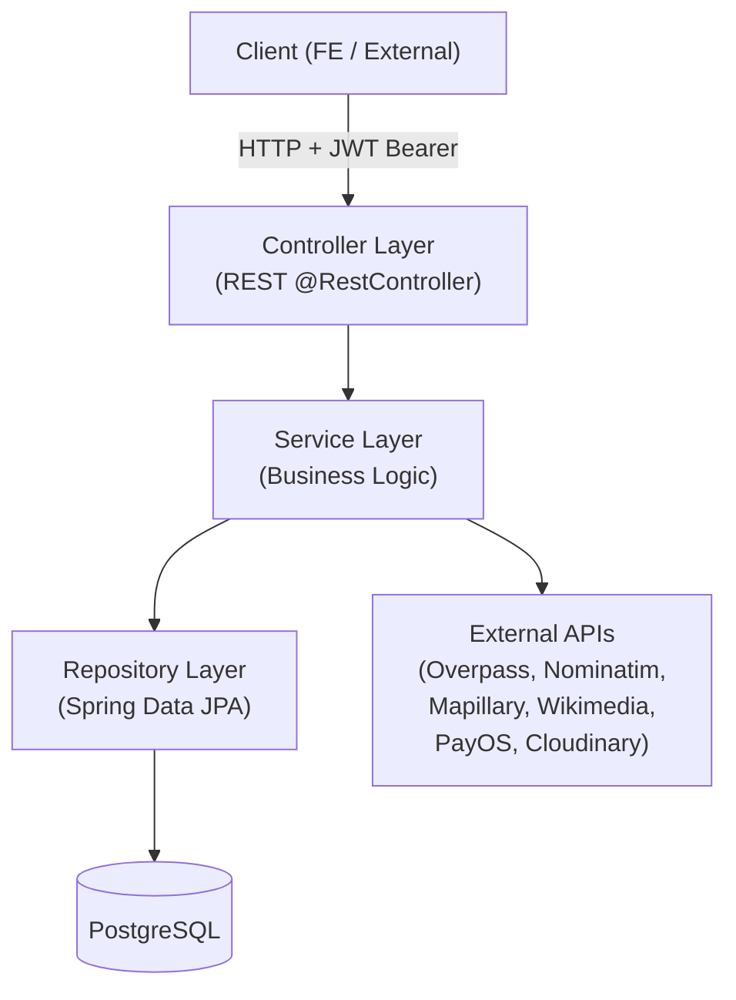

# WayveeSystem — Backend Architecture

> **Mục đích file này:** Mô tả kiến trúc tổng thể, các package/layer, và luồng xử lý chính của BE.  
> AI agent đọc file này thay vì dò toàn bộ source khi cần context.

---

## 1. Tổng quan

| Mục | Thông tin |
|-----|-----------|
| **Framework** | Spring Boot 4.1.1 (Java 21) |
| **Build tool** | Maven |
| **Database** | PostgreSQL (JPA / Hibernate) |
| **Auth** | JWT (OAuth2 Resource Server) + Custom JWT Decoder |
| **Caching** | Caffeine (in-memory) |
| **Email** | Resend SDK + Spring Mail + Thymeleaf templates |
| **Image** | Cloudinary HTTP5 SDK |
| **Payment** | PayOS SDK (`vn.payos`) |
| **Map data** | Overpass API (OSM) + Nominatim (reverse geocode) + Mapillary + Wikimedia |
| **API Docs** | SpringDoc OpenAPI 3 / Swagger UI |
| **Async** | Spring `@Async` (AsyncConfig) |
| **Roles** | `ROLE_USER`, `ROLE_ADMIN` |

---

## 2. Cấu trúc package

```
org.example.wayveesystem
├── WayveeSystemApplication.java          ← Entry point
├── common/
│   ├── client/        ← HTTP clients ra ngoài (OverpassApiClient)
│   ├── enums/         ← Enums toàn hệ thống
│   ├── exception/     ← AppException, ErrorCode, GlobalExceptionHandler
│   ├── response/      ← ApiResponse<T> wrapper chuẩn
│   ├── scheduler/     ← Scheduled jobs (PoiCachePrewarmer)
│   └── strategy/      ← OSM filter strategies (OsmFilterFactory, CategoryOsmFilterStrategy, CuisineOsmFilterStrategy)
├── configuration/     ← Spring Beans & Security config
├── controller/        ← REST endpoints (HTTP layer)
├── dto/
│   ├── request/       ← Request DTOs
│   └── response/      ← Response DTOs
├── mapper/            ← Entity ↔ DTO mapping (thủ công, không dùng MapStruct)
├── model/             ← JPA Entities
├── repository/        ← Spring Data JPA repositories
└── service/
    ├── *.java         ← Service interfaces
    ├── impl/          ← Service implementations
    ├── poi/strategy/  ← POI source strategies (OSM, Overture)
    └── replanning/    ← Trip replanning engine
        ├── constraint/   ← Constraint checkers
        ├── distance/     ← Distance calculators
        ├── model/        ← Replan domain models
        └── planner/      ← Insertion planner, local search optimizer
```

---

## 3. Layer Architecture



---

## 4. Security

- **SecurityConfig** định nghĩa filter chain:
  - Public endpoints: `/api/auth/**`, `/api/locations/**`, `/api/categories/**`, `/api/reviews/**`, `/api/website-reviews/**`, `/api/favorites/**`, `/api/subscriptions/**`, `/api/trips/**`, `/api/payments/payos-webhook`, Swagger UI.
  - Admin-only: `/api/admin/**` → `hasRole("ADMIN")`
  - Các endpoints còn lại: `.authenticated()`
- **CustomJwtDecoder**: decode + validate JWT tự build
- JWT claim `scope` chứa `ROLE_USER` / `ROLE_ADMIN` (không thêm prefix)
- CORS: cho phép tất cả origins với credentials

---

## 5. Controllers & Endpoints

| Controller | Base path | Chức năng |
|---|---|---|
| `AuthenticationController` | `/api/auth` | Đăng ký, đăng nhập, logout, refresh token, OTP, verify email, reset password |
| `LocationController` | `/api/locations`, `/api/v1/locations` | CRUD địa điểm, filter, pagination |
| `CategoryController` | `/api/categories`, `/api/v1/categories` | CRUD danh mục POI |
| `FavoriteController` | `/api/favorites` | Thêm/xóa địa điểm yêu thích |
| `ReviewController` | `/api/reviews`, `/api/v1/reviews` | CRUD reviews cho địa điểm |
| `WebsiteReviewController` | `/api/website-reviews`, `/api/v1/website-reviews` | Reviews về website Wayvee |
| `TripController` | `/api/trips`, `/api/v1/trips` | CRUD trips của user |
| `TripReplanningController` | `/api/trips/replan` | Preview & confirm trip replanning |
| `SubscriptionController` | `/api/subscriptions` | Quản lý gói Premium |
| `PaymentController` | `/api/payments` | Tạo payment link (PayOS), webhook |
| `PoiImportController` | `/api/poi-import` | Import POI từ Overpass/file |
| `AnalyticsController` | `/api/analytics` | Dashboard stats (admin) |
| `AdminUserController` | `/api/admin/users` | Quản lý users (admin) |
| `AdminPaymentController` | `/api/admin/payments` | Quản lý payments (admin) |

---

## 6. Data Models (JPA Entities)

| Entity | Mô tả | Key fields |
|---|---|---|
| `User` | Tài khoản người dùng | id, email, password, role (ROLE_USER/ADMIN), status, subscriptionPlan |
| `Trip` | Chuyến đi của user | id, userId, name, startDate, endDate, status (DRAFT/ACTIVE/COMPLETED) |
| `TripLocation` | Địa điểm trong trip | id, tripId, locationId, dayIndex, orderIndex, status, scheduledTime |
| `PoiCatalog` | Địa điểm POI từ OSM | id, osmId, name, lat, lng, categoryCode, tags, status |
| `Category` | Danh mục địa điểm | id, code (CategoryCode enum), name, icon |
| `Favorite` | Địa điểm yêu thích | id, userId, locationId |
| `Review` | Đánh giá địa điểm | id, userId, locationId, rating, comment |
| `WebsiteReview` | Đánh giá website | id, userId, rating, comment |
| `Subscription` | Gói subscription | id, userId, planType, status, startDate, endDate |
| `Payment` | Thanh toán | id, userId, subscriptionId, method, status, amount |
| `InvalidatedToken` | Token đã logout | id (jti), expiryTime |
| `OtpEmail` | OTP cho email | id, email, otp, expiryTime |
| `SavedPlace` | Địa điểm đã lưu | id, userId, placeId |
| `Route` | Tuyến đường | id, tripId, geometry |
| `LocationOpeningHour` | Giờ mở cửa địa điểm | id, locationId, dayOfWeek, open/closeTime |

---

## 7. Enums

| Enum | Values |
|---|---|
| `Role` | ROLE_USER, ROLE_ADMIN |
| `UserStatus` | ACTIVE, INACTIVE, BANNED |
| `TripStatus` | DRAFT, ACTIVE, COMPLETED, CANCELLED |
| `TripLocationStatus` | PENDING, VISITED, SKIPPED |
| `SubscriptionPlanType` | FREE, PREMIUM_MONTHLY, PREMIUM_YEARLY |
| `SubscriptionStatus` | ACTIVE, EXPIRED, CANCELLED |
| `PaymentMethod` | PAYOS, BANK_TRANSFER |
| `PaymentStatus` | PENDING, SUCCESS, FAILED, CANCELLED |
| `PoiStatus` | ACTIVE, INACTIVE, PENDING |
| `CategoryCode` | (các mã danh mục địa điểm) |
| `ImageSource` | CLOUDINARY, MAPILLARY, WIKIMEDIA, OSM_DIRECT |
| `LocationSource` | OSM, OVERTURE, MANUAL |
| `LocationPriority` | HIGH, MEDIUM, LOW |
| `ReplanAction` | ADD, REMOVE, MOVE, REPLACE |
| `ReplanSeverity` | INFO, WARNING, CRITICAL |

---

## 8. Services chính

### 8.1 AuthenticationService
- Đăng ký (`signup`): tạo user, gửi OTP email verify
- Đăng nhập (`login`): validate, tạo JWT, trả về `AuthenticationResponse`
- Logout: invalidate token (lưu `InvalidatedToken`)
- Refresh token
- OTP flow: gửi OTP → verify → reset password

### 8.2 LocationService / LocationServiceImpl
- Tìm kiếm địa điểm với filter (category, bounding box, keyword)
- Pagination
- Lấy chi tiết địa điểm kèm reviews, giờ mở cửa, ảnh

### 8.3 PoiImportService
- Import POI từ Overpass API (OSM) → lưu vào `PoiCatalog`
- Hỗ trợ import từ file CSV / server file
- Strategy pattern: `OsmPoiSourceStrategy`, `OverturePoiSourceStrategy`
- `OsmFilterFactory` + `CategoryOsmFilterStrategy` + `CuisineOsmFilterStrategy` xây Overpass query

### 8.4 TripService
- CRUD trips
- Thêm/xóa/sắp xếp `TripLocation` trong trip
- Optimize thứ tự địa điểm: `TripOptimizationService`

### 8.5 TripReplanningService (phức tạp nhất)
- **Luồng replanning:**
  1. `previewReplan(request)` → tính toán, lưu `ReplanProposal` vào `ReplanProposalStore` (in-memory)
  2. `confirmReplan(proposalId)` → áp dụng proposal vào DB
- **Sub-components:**
  - `InsertionPlanner`: tìm slot tốt nhất để insert địa điểm mới
  - `LocalSearchOptimizer`: tối ưu thứ tự bằng local search
  - `DistanceMatrixCalculator` + `HaversineDistanceCalculator`: tính khoảng cách
  - Constraint checkers: `DayTimeBudgetChecker`, `FixedDayChecker`, `ScheduleTimeEvaluator`

### 8.6 PaymentService
- Tạo payment link qua PayOS API
- Handle webhook từ PayOS
- Cập nhật `Payment` và `Subscription` status

### 8.7 ImageResolverService
- Pipeline resolve ảnh cho địa điểm:
  `Cloudinary` → `Mapillary` → `Wikimedia` → `OSM Direct`
- `ImageCacheStore` (in-memory Caffeine cache)
- `GeoImageSearchService`: tìm ảnh theo toạ độ

### 8.8 EmailService / AgentMailService
- Gửi OTP email, welcome email
- Dùng Resend SDK + Thymeleaf templates

---

## 9. Configuration Beans

| Config class | Mục đích |
|---|---|
| `SecurityConfig` | Spring Security filter chain, CORS |
| `CustomJwtDecoder` | Decode và validate JWT |
| `AppConfig` | PasswordEncoder, RestTemplate, WebClient |
| `AsyncConfig` | ThreadPoolTaskExecutor cho @Async |
| `CacheConfig` | Caffeine cache manager |
| `CloudinaryConfig` | Cloudinary SDK setup |
| `PayOSConfig` | PayOS SDK setup |
| `NominatimConfig` | Nominatim reverse geocode client |
| `OverpassConfig` | Overpass API config |
| `OpenApiConfig` | SpringDoc / Swagger setup |
| `ApplicationInitConfig` | Khởi tạo admin user khi start |
| `CategoryInit` | Seed dữ liệu categories |
| `WebsiteReviewInit` | Seed dữ liệu website reviews |

---

## 10. Response format chuẩn

```json
{
  "code": 1000,
  "message": "Success",
  "data": { ... }
}
```

- `code = 1000` (hoặc 200): thành công
- Lỗi: `AppException(ErrorCode)` → `GlobalExceptionHandler` → `ApiResponse` với code và message tương ứng

---

## 11. External APIs tích hợp

| API | Dùng cho |
|---|---|
| **Overpass API (OSM)** | Lấy POI theo bounding box + filter tags |
| **Nominatim** | Reverse geocoding (tọa độ → địa chỉ) |
| **Mapillary** | Ảnh đường phố (image resolve) |
| **Wikimedia** | Ảnh Wikipedia cho địa điểm |
| **PayOS** | Thanh toán (tạo link, webhook) |
| **Cloudinary** | Upload và lưu trữ ảnh user |
| **Resend** | Gửi email transactional |

---

## 12. Files quan trọng để đọc nhanh

| Mục tiêu | File |
|---|---|
| Hiểu security / public endpoints | `configuration/SecurityConfig.java` |
| Hiểu JWT | `configuration/CustomJwtDecoder.java` |
| Hiểu error handling | `common/exception/ErrorCode.java`, `GlobalExceptionHandler.java` |
| Hiểu replanning logic | `service/replanning/` (toàn bộ package) |
| Hiểu POI import | `service/impl/PoiImportServiceImpl.java`, `service/poi/strategy/` |
| Hiểu payment | `service/impl/PaymentServiceImpl.java`, `controller/PaymentController.java` |
| Hiểu entities | `model/*.java` |
| Hiểu API endpoints | `controller/*.java` |

